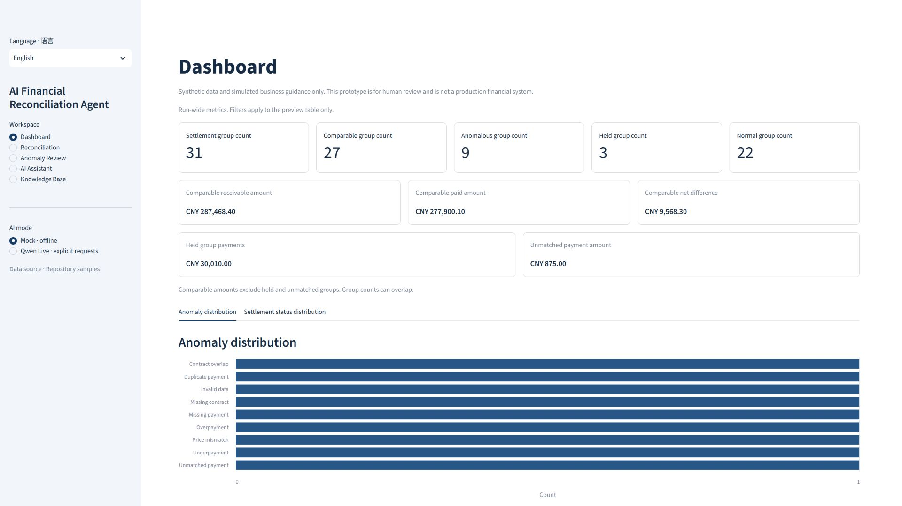
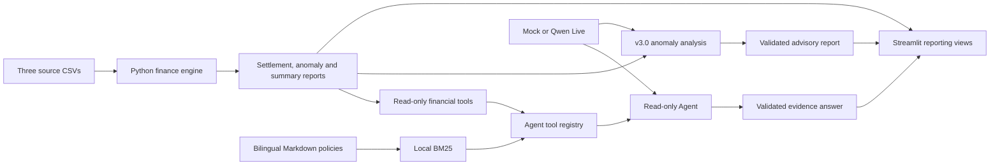
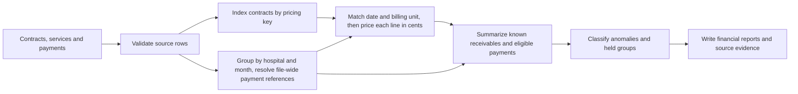
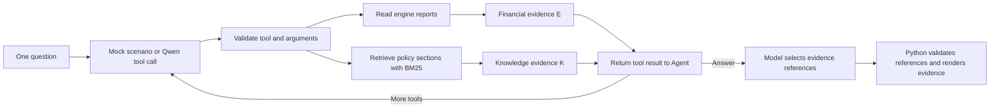
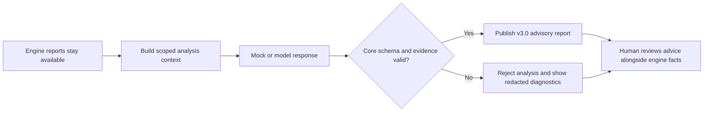

# AI Financial Reconciliation Agent

[简体中文](README_CN.md)

## Project Overview

A bilingual, Windows-local Streamlit prototype for reconciling synthetic hospital testing charges and payments. A deterministic Python engine calculates the financial result. An optional AI layer proposes review actions and answers read-only questions with traceable evidence. The complete demo runs in Mock mode without an API key.

## Business Problem

Reviewers need to determine which contract and billing unit applied on the service date, compare the resulting receivable with eligible payments, and investigate discrepancies. Payments may arrive in installments or be imported twice. Overlapping contracts can leave a known payment without an authoritative receivable or variance. The application keeps that group on hold and exposes the supporting records for human review.

## Key Features

- Contract matching by hospital, test, collection and service type, with inclusive effective dates and billing-unit checks. Line charges and settlement totals use exact integer cents.
- Nine anomaly types covering missing, underpaid, overpaid, duplicate and unmatched payments, price differences, missing or overlapping contracts, and invalid data.
- Bilingual v3.0 analysis with catalog-backed hypotheses and review actions, advisory priorities, JSON and Markdown reports, and schema and evidence validation.
- Six allowlisted, read-only Agent tools. Five query engine records and review priorities, and one searches the simulated business knowledge base with local English and Simplified Chinese BM25.
- Financial evidence uses `E` references. Knowledge citations use `K` references with document sections. The engine's amounts, business priorities and human-review requirements remain authoritative if AI fails or suggests a different priority.

## Application Preview

These screenshots show the local Streamlit app with repository samples in offline Mock mode.



The Dashboard separates comparable balances, held payments and unmatched payments. Follow `SIM-H004` in May 2026 through the other pages.

| View | Screenshot |
| --- | --- |
| Dashboard | [Settlement status distribution](docs/assets/screenshots/01b-dashboard-settlement-status-en-mock.png) |
| Reconciliation | [Completed sample run and filtered held settlement](docs/assets/screenshots/02-reconciliation-held-en-mock.png) |
| Anomaly Review | [Contract overlap, candidate contracts and review actions](docs/assets/screenshots/03-anomaly-contract-overlap-en-mock.png) |
| AI Assistant | [Mock answer and simulated request metrics](docs/assets/screenshots/04-assistant-combined-en-mock.png) · [E1 financial and K1 knowledge evidence](docs/assets/screenshots/04b-assistant-evidence-en-mock.png) |
| Knowledge Base | [BM25 results for contract overlap](docs/assets/screenshots/05-knowledge-contract-overlap-en-mock.png) |
| Simplified Chinese views | [Contract overlap review](docs/assets/screenshots/06-anomaly-contract-overlap-cn-mock.png) · [Duplicate-payment search](docs/assets/screenshots/07-knowledge-duplicate-payment-cn-mock.png) |

### Qwen Live browser demo

The user's Step 08B browser run on the same synthetic data used `qwen3.8-flash`. The combined query completed with validated evidence references, 3 model requests, 3 tool calls, 7,200 total tokens and 5.148 seconds. `E1` shows the held settlement and `K1` shows the simulated policy sources and review guidance. [Live answer and financial evidence](docs/assets/screenshots/08-assistant-combined-en-live.png) · [Live knowledge evidence](docs/assets/screenshots/08b-assistant-evidence-en-live.png)

The separate Live anomaly analysis shows five differences between business priority and AI suggested priority. All nine findings still require human review. [Live priority comparison](docs/assets/screenshots/09-anomaly-priority-en-live.png) · [Step 08B acceptance record](docs/test_report.md#step-08b-screenshot-delivery-and-final-acceptance)

## System Architecture



The engine runs without a model. The standalone analysis and the Agent use separate response contracts. The Agent's knowledge branch supplies simulated guidance. Financial amounts always come from the engine. [Module responsibilities](docs/repository_guide.md) · [Architecture details](docs/architecture.md)

## Technology Stack

| Layer | Implementation |
| --- | --- |
| Core | Python standard library, CSV and JSON, integer-cent arithmetic |
| App | Streamlit 1.66.0 with English and Simplified Chinese views |
| Model access | Qwen via the OpenAI Python SDK 2.54.0 and HTTPX 0.28.1. OpenAI analysis has offline verification only. |
| Retrieval | Local BM25 over 12 bilingual Markdown files with 36 indexed sections |
| Verification | `unittest`, Streamlit AppTest and simulated HTTP transport |

Windows acceptance used Python 3.13.7. Python 3.13 is the reproducible setup below. The pinned Streamlit package declares Python 3.11 or later. [Pinned dependencies](requirements.txt)

## Business and AI Workflow

### Deterministic reconciliation



The net difference is expected minus paid when both amounts are known and comparable. Held and unmatched payments are reported separately. [Financial rules](docs/architecture.md) · [Input fields](docs/data_dictionary.md)

### Agent and RAG tool calls



The final answer can cite only successful lookups from that question. Policy sections describe what to review. The Agent has read-only tools for querying evidence and lacks contract selection, report mutation and payment actions. [Agent design](docs/agent_design.md) · [RAG design](docs/rag_design.md)

### Analysis validation and failure isolation



Invalid core output clears stale AI analysis in the app. The financial snapshot and deterministic business priorities remain available. Invalid optional notes are omitted with a recorded reason when the core report passes. [Analysis contract](docs/llm_integration.md) · [Streamlit design](docs/streamlit_design.md)

## Demo Case: Contract Overlap

Open **Anomaly Review** and select `ANOM-000006` for `SIM-H004` in `2026-05`. Service `SIM-S0273` took place on **2026-05-07** and records **39 pools** of PCR `POOL_20` `MASS_SCREENING` with billing unit `POOL`.

| Candidate | Inclusive effective dates | Contract unit price |
| --- | --- | ---: |
| `SIM-C0024` | 2026-01-01 to 2026-06-30 | CNY 24.30 per pool |
| `SIM-C0032` | 2026-05-07 to 2026-05-07 | CNY 25.00 per pool |

Both candidates cover the service date. The reported charge of CNY 947.70 agrees with one candidate's rate and does not establish an authorized contract version. The engine flags `CONTRACT_OVERLAP`, keeps settlement `REVIEW_REQUIRED` and classifies the known payment **CNY 10406.50** as `HELD`. Receivable and difference remain unknown.

In **AI Assistant**, choose the combined contract-overlap question. The Step 08B Live captures show the settlement in `E1` and guidance from KB-06 §1, KB-01 §2 and KB-06 §2 in `K1`. A human must confirm the applicable approved contract and resolve overlapping dates before recalculation. The model cannot select a binding contract, substitute an amount, or release a payment. [Synthetic contract records](data/sample/contracts.csv) · [Simulated contract policy](knowledge_base/02-contract-pricing.en.md) · [Live screenshot record](docs/test_report.md#step-08b-screenshot-delivery-and-final-acceptance)

In the Step 08B Live analysis, `ANOM-000006` retained business priority **High** while its AI suggestion was **Medium**. Five suggestions differed from business priority. All nine findings still required human review. [Step 08B priority comparison](docs/assets/screenshots/09-anomaly-priority-en-live.png) · [Earlier Step 07 acceptance](docs/test_report.md#step-07-final-acceptance-and-checkpoint-03)

## Quick Start

Run from the repository root in Windows PowerShell. Create `.venv` on a fresh checkout. If it already exists with the tested Python version, start at the install command.

```powershell
python --version
python -m venv .venv
.\.venv\Scripts\python.exe -B -m pip install -r requirements.txt
.\.venv\Scripts\python.exe -B -m streamlit run app.py --server.address=127.0.0.1 --server.port=8501
```

Open [the local app](http://127.0.0.1:8501). It starts in English, Mock mode and loads the repository samples. To follow the demo without a key, open **Anomaly Review**, select `ANOM-000006`, then use the combined contract-overlap example in **AI Assistant**. Stop Streamlit with `Ctrl+C` in its terminal.

To reproduce the three CLI stages without replacing baseline reports, use a separate local output folder.

```powershell
.\.venv\Scripts\python.exe -B main.py --input-dir data/sample --output-dir outputs/demo
.\.venv\Scripts\python.exe -B analyze.py --input-dir outputs/demo --output-dir outputs/demo --provider mock --language both
.\.venv\Scripts\python.exe -B agent_cli.py 'Why is the May 2026 settlement for SIM-H004 on hold, and what should the finance team do next?' --input-dir outputs/demo --mock-scenario combined --language en --json
```

The engine writes `reconciliation_results.csv`, `anomaly_details.csv` and `summary.json`. Mock analysis writes bilingual JSON and Markdown alongside them. Use `--language cn` on the Agent CLI for Simplified Chinese. [Local usage and troubleshooting](docs/streamlit_guide.md)

## Mock and Live Modes

- **Mock** runs locally using deterministic analysis and scripted Agent examples. It needs no API key and makes no model API call.
- **Qwen Live in Streamlit** requires an approved Alibaba Cloud HTTPS Base URL ending in `/compatible-mode/v1`, a model name, a masked DashScope key and the **Authorize this Live request** checkbox. Requests start only on explicit submission, with zero automatic retries. The URL, key and consent clear afterward.
- **Qwen Live in the CLI** uses `QWEN_BASE_URL` and `QWEN_MODEL`. Analysis uses `DASHSCOPE_API_KEY` and `analyze.py --provider qwen`. Agent runs require `--provider qwen --live`. Add `--prompt-key` to enter the Agent key without echo. Live usage may incur account charges. [Live setup and verification](docs/llm_integration.md) · [Agent commands](docs/agent_design.md#commands-and-acceptance)

## Testing and Validation

```powershell
.\.venv\Scripts\python.exe -B -m unittest discover -s tests
.\.venv\Scripts\python.exe -B -m pip check
```

The offline suite passed **227 tests**, including AppTest and simulated HTTP for success, failure and rerun safety. Separately, user-run browser Qwen Live verified both the combined Agent + RAG query and anomaly analysis after Step 07G. The test report preserves the earlier Live failures, fixes and retest. This scope does not establish model accuracy or production reliability. [Test report and acceptance history](docs/test_report.md)

## Safety and Reliability

- Use synthetic data and simulated guidance only. The engine and UI preserve unknown amounts and held states. AI responses cannot change amounts, settlement status or business priority.
- The analysis layer validates required fields, selection codes and scoped evidence. The Agent validates tool arguments and final evidence references. Failed validation withholds AI output and preserves the financial results.
- The app requires explicit authorization, uses transient credentials, and displays redacted diagnostics. Human reviewers confirm contract applicability, priorities and next actions. The system has no payment or settlement-approval tool.

## Repository Structure

```text
.
├── app.py, main.py, analyze.py, agent_cli.py
├── data/sample/          # Three source CSVs and one test oracle
├── src/                  # Finance, analysis, Agent, tools and BM25
├── knowledge_base/       # Six simulated policies in two languages
├── ui/                   # Streamlit views, services, state and labels
├── tests/                # Unit, integration, AppTest and simulated HTTP
├── scripts/              # Fixture generation and explicit Live verification
├── docs/                 # Requirements, design and acceptance records
├── .streamlit/config.toml
├── .env.example, .gitignore, requirements.txt
└── outputs/              # Generated locally and Git-ignored
```

[Expanded directory tree and module guide](docs/repository_guide.md)

## Documentation

| Document | Contents |
| --- | --- |
| [Product requirements](docs/PRD.md) · [简体中文](docs/PRD_CN.md) | Business scope, requirements and MVP boundaries |
| [Data dictionary](docs/data_dictionary.md) · [Architecture](docs/architecture.md) | Inputs, pricing, payment controls and component contracts |
| [LLM integration](docs/llm_integration.md) · [Agent](docs/agent_design.md) · [RAG](docs/rag_design.md) | Providers, schemas, tools and evidence |
| [App design](docs/streamlit_design.md) · [Local usage](docs/streamlit_guide.md) | UI behavior, setup and diagnostic procedures |
| [Test report](docs/test_report.md) · [Screenshot guide](docs/demo_capture_plan.md) | Offline and Live evidence, published captures and reproduction steps |

## Known Limitations

- This is a local MVP for synthetic CNY data and simulated policies. Production deployment and reliability have not been validated.
- BM25 relies on lexical overlap and may miss paraphrases. Live output may still fail the contract even when the model responds.
- One question runs at a time. Persistent reviewer decisions, multi-question memory, cross-period allocation and payment-deadline assessment are outside the delivered scope.
