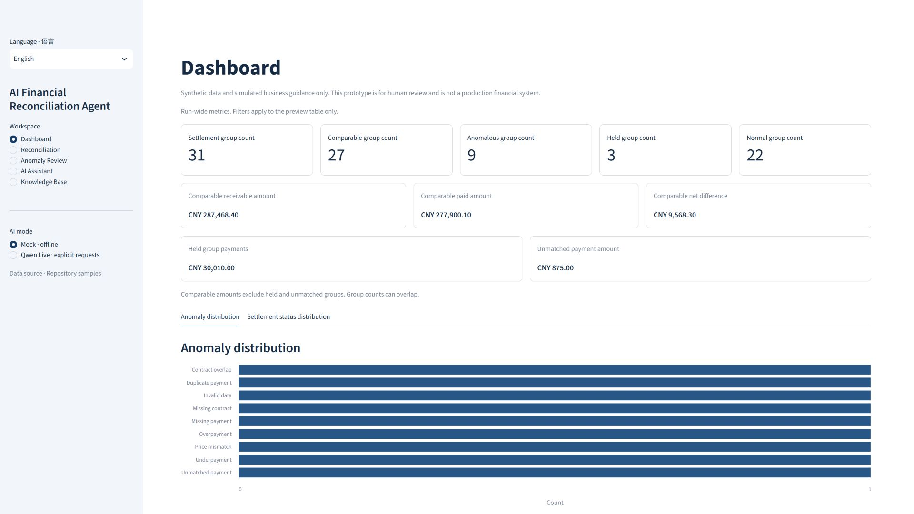
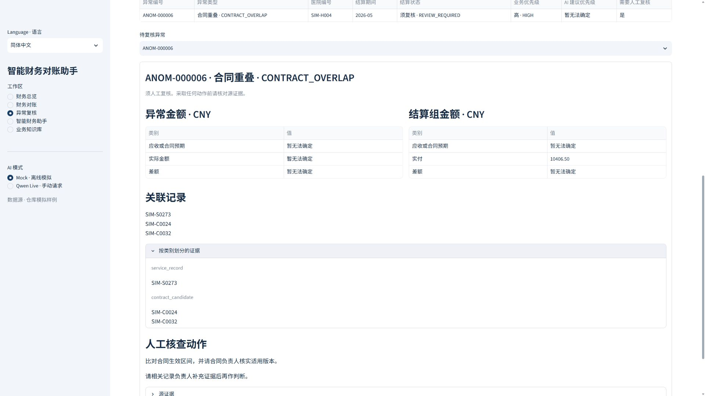
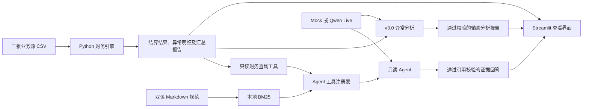
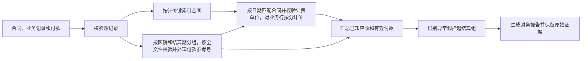
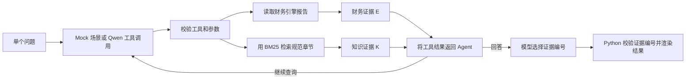
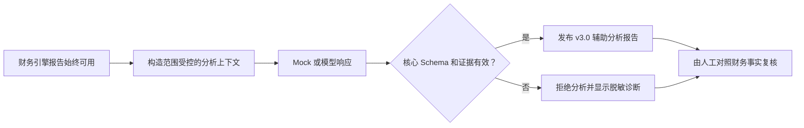

# AI 智能财务对账与异常分析助手

[English](README.md)

## 项目概述

面向模拟医院检测收费与付款对账的 Windows 本地双语 Streamlit 原型。确定性 Python 引擎负责计算财务结果，AI 层可选，用于提出人工复核建议和回答有可追溯证据的只读问题。完整演示可在 Mock 模式下运行，无需 API Key。

## 业务问题

复核人员需要查明业务发生日适用的合同和计费单位，将应收与有效付款核对，并追查差异。付款可能分笔到账，记录也可能被重复导入。合同有效期重叠时，即使实付已知，也无法确定权威的应收和差额。应用挂起相关结算组，并展示供人工复核的原始记录。

## 核心功能

- 按医院、检测科目、采集方式和业务类型匹配合同，校验计费单位并包含有效期起止日。业务费用和结算汇总均使用整数分精确计算。
- 检测九类异常，覆盖缺少付款、少付、多付、重复付款、无对应业务付款、价格差异、缺少合同、合同重叠及无效数据。
- 双语 v3.0 分析使用原因和核查动作编码库，提供建议优先级和 JSON、Markdown 报告，并校验 Schema 与证据。
- Agent 有六个白名单内的只读工具。其中五个查询财务引擎结果和复核优先级，一个通过本地 BM25 检索中英文模拟业务规范。
- 财务证据使用 `E` 编号，知识证据使用带文档章节的 `K` 编号。AI 调用失败或给出不同优先级时，财务引擎金额、业务优先级和人工复核要求仍然有效。

## 应用预览

以下为本地 Streamlit 使用仓库样例、在 Mock 离线模式下的实际截图。



财务总览分别展示可比较金额、挂起付款和无对应业务付款。中文异常复核展示 `SIM-H004` 在 `2026-05` 的实付、未知金额及候选合同。



| 页面 | 截图 |
| --- | --- |
| 财务总览 | [英文结算状态分布](docs/assets/screenshots/01b-dashboard-settlement-status-en-mock.png) |
| 财务对账 | [英文样例对账完成及挂起组筛选](docs/assets/screenshots/02-reconciliation-held-en-mock.png) |
| 异常复核 | [英文合同重叠、候选合同和复核动作](docs/assets/screenshots/03-anomaly-contract-overlap-en-mock.png) |
| 智能财务助手 | [英文 Mock 回答及模拟请求统计](docs/assets/screenshots/04-assistant-combined-en-mock.png) · [E1 财务证据与 K1 知识证据](docs/assets/screenshots/04b-assistant-evidence-en-mock.png) |
| 业务知识库 | [英文合同重叠检索](docs/assets/screenshots/05-knowledge-contract-overlap-en-mock.png) · [中文重复付款检索](docs/assets/screenshots/07-knowledge-duplicate-payment-cn-mock.png) |

### Qwen Live 浏览器演示

Step 08B 中，用户在本地浏览器用相同模拟数据运行 `qwen3.8-flash`。联合查询通过证据引用校验，记录 3 次模型请求、3 次工具调用、7,200 个 Token 及 5.148 秒耗时。`E1` 展示挂起结算，`K1` 展示模拟规范出处及人工核查建议。 [Live 回答与财务证据](docs/assets/screenshots/08-assistant-combined-en-live.png) · [Live 知识证据](docs/assets/screenshots/08b-assistant-evidence-en-live.png)

独立的 Live 异常分析中，五项 AI 建议优先级与业务优先级不同，九项异常均仍须人工复核。 [Live 优先级对照](docs/assets/screenshots/09-anomaly-priority-en-live.png) · [Step 08B 验收记录](docs/test_report.md#step-08b-screenshot-delivery-and-final-acceptance)

## 系统架构



财务引擎可独立于模型运行。异常分析和 Agent 使用各自的输出契约。Agent 的知识检索分支提供模拟核查指引，财务金额由引擎提供。[模块职责](docs/repository_guide.md) · [架构详解](docs/architecture.md)

## 技术栈

| 层 | 实现 |
| --- | --- |
| 核心引擎 | Python 标准库、CSV 和 JSON、整数分计算 |
| 应用 | Streamlit 1.66.0，支持英文和简体中文 |
| 模型接入 | Qwen 复用 OpenAI Python SDK 2.54.0 和 HTTPX 0.28.1，OpenAI 分析仅完成离线验证 |
| 检索 | 本地 BM25，索引 12 份中英文 Markdown 的 36 个章节 |
| 验证 | `unittest`、Streamlit AppTest、模拟 HTTP 传输 |

Windows 验收使用 Python 3.13.7。下方示例用 Python 3.13 复现环境。锁定版本的 Streamlit 声明要求 Python 3.11 或更高版本。[锁定的依赖](requirements.txt)

## 业务与 AI 流程

### 确定性对账流程



当应收和实付均已知且可比较时，差额为应收减实付。挂起和无对应业务的付款分别统计。[财务规则](docs/architecture.md) · [输入字段](docs/data_dictionary.md)

### Agent 与 RAG 工具调用



最终回答只能引用本次问题中成功获取的证据。知识章节给出核查指引。Agent 的工具只读，无法选定合同、修改报告或执行付款。[Agent 设计](docs/agent_design.md) · [RAG 设计](docs/rag_design.md)

### AI 输出校验与失败隔离



核心输出无效时，应用清除旧 AI 分析，保留财务快照和确定性业务优先级。核心校验通过时，不合规的补充文本仍会被省略并记录原因。[分析契约](docs/llm_integration.md) · [Streamlit 设计](docs/streamlit_design.md)

## 演示案例：合同重叠

进入**异常复核**，选择 `SIM-H004` 在 `2026-05` 的 `ANOM-000006`。业务 `SIM-S0273` 发生于 **2026-05-07**，检测类型为 PCR，采集方式为 `POOL_20`，业务类型为 `MASS_SCREENING`，计费单位为 `POOL`，共 **39 池**。

| 候选合同 | 有效期（含首尾日） | 合同单价 |
| --- | --- | ---: |
| `SIM-C0024` | 2026-01-01 至 2026-06-30 | CNY 24.30 / 池 |
| `SIM-C0032` | 2026-05-07 至 2026-05-07 | CNY 25.00 / 池 |

两份合同都覆盖该业务发生日。报送金额 CNY 947.70 与其中一份合同单价相符，但无法据此确认获批的合同版本。引擎标记 `CONTRACT_OVERLAP`，保留结算状态 `REVIEW_REQUIRED`，把已知实付 **CNY 10406.50** 归为 `HELD`。应收与差额保持未知。

在**智能财务助手**选择合同重叠联合问答示例。Step 08B 的 Live 截图通过 `E1` 展示结算证据，并通过 `K1` 展示 KB-06 §1、KB-01 §2 和 KB-06 §2 的指引。人工须确认适用且获批的合同版本，解决有效期重叠后再重新计算。模型无权选定合同、代填金额或放行付款。 [模拟合同记录](data/sample/contracts.csv) · [模拟合同规范](knowledge_base/02-contract-pricing.cn.md) · [Live 截图验收记录](docs/test_report.md#step-08b-screenshot-delivery-and-final-acceptance)

Step 08B 的 Live 异常分析中，`ANOM-000006` 的业务优先级保持 **High**，AI 建议为 **Medium**。共有五项建议与业务优先级不同，九项仍须人工复核。 [Step 08B 优先级对照](docs/assets/screenshots/09-anomaly-priority-en-live.png) · [此前的 Step 07 验收](docs/test_report.md#step-07-final-acceptance-and-checkpoint-03)

## 快速启动

在 Windows PowerShell 中从仓库根目录执行。首次使用时先创建 `.venv`。已有使用验收版本 Python 的虚拟环境时，从安装依赖开始。

```powershell
python --version
python -m venv .venv
.\.venv\Scripts\python.exe -B -m pip install -r requirements.txt
.\.venv\Scripts\python.exe -B -m streamlit run app.py --server.address=127.0.0.1 --server.port=8501
```

打开[本地应用](http://127.0.0.1:8501)。默认使用 English、Mock 模式和仓库样例，可切换简体中文。无需 API Key，先在**异常复核**选择 `ANOM-000006`，再到**智能财务助手**选择合同重叠联合问答示例。在启动终端按 `Ctrl+C` 停止应用。

以下命令使用独立的本地目录复现三个 CLI 阶段，避免覆盖基线报告。

```powershell
.\.venv\Scripts\python.exe -B main.py --input-dir data/sample --output-dir outputs/demo
.\.venv\Scripts\python.exe -B analyze.py --input-dir outputs/demo --output-dir outputs/demo --provider mock --language both
.\.venv\Scripts\python.exe -B agent_cli.py 'SIM-H004 在 2026-05 的结算为何挂起，财务团队接下来应该怎么做？' --input-dir outputs/demo --mock-scenario combined --language cn --json
```

引擎生成 `reconciliation_results.csv`、`anomaly_details.csv` 和 `summary.json`。Mock 分析在同一目录生成中英文 JSON 和 Markdown。Agent CLI 可用 `--language en` 切回英文。[本地用法及故障排查](docs/streamlit_guide.md)

## Mock 与 Live 模式

- **Mock** 在本地生成确定性模拟分析，并按预设 Agent 场景演示，不需要 API Key，也不会调用模型 API。
- **Streamlit Qwen Live** 需要经批准的阿里云 HTTPS Base URL，路径以 `/compatible-mode/v1` 结尾，并填写模型名、隐藏的 DashScope Key，勾选 **授权本次 Live 请求**。仅显式提交时调用，零自动重试。提交后清空 URL、密钥和授权状态。
- **CLI Qwen Live** 使用 `QWEN_BASE_URL` 和 `QWEN_MODEL`。异常分析使用 `DASHSCOPE_API_KEY` 及 `analyze.py --provider qwen`。Agent 必须使用 `--provider qwen --live`，可加 `--prompt-key` 隐藏输入密钥。Live 用量可能产生账户费用。[Live 配置与验证](docs/llm_integration.md) · [Agent 命令](docs/agent_design.md#commands-and-acceptance)

## 测试与验证

```powershell
.\.venv\Scripts\python.exe -B -m unittest discover -s tests
.\.venv\Scripts\python.exe -B -m pip check
```

**227 项离线测试全部通过**，包括 AppTest 和模拟 HTTP 覆盖的成功、失败及 rerun 安全性。用户另行使用真实 Qwen Live，通过浏览器 Agent + RAG 联合查询和 Step 07G 修复后的异常分析复测。测试报告保留之前的真实失败、修复及复测记录。该验收范围无法衡量模型准确率或生产可靠性。[测试报告及验收历史](docs/test_report.md)

## 安全与可靠性

- 仅使用模拟数据和模拟业务规范。引擎和界面保留未知金额及挂起状态。AI 输出无法覆盖金额、结算状态或业务优先级。
- 分析层校验必填字段、原因与动作编码及证据范围。Agent 校验工具参数与最终证据编号。校验失败时拒绝 AI 输出，财务结果仍可用。
- 应用要求显式授权，凭证仅在提交时临时使用，错误诊断经过脱敏。人工负责确认适用合同、优先级及后续动作。系统没有付款或审批结算的工具。

## 仓库结构

```text
.
├── app.py, main.py, analyze.py, agent_cli.py
├── data/sample/          # 三张源表和一张测试预期表
├── src/                  # 财务引擎、分析、Agent、工具及 BM25
├── knowledge_base/       # 六类模拟规范，每类中英文各一份
├── ui/                   # Streamlit 页面、服务、状态和文案
├── tests/                # 单元测试、集成测试、AppTest 和模拟 HTTP
├── scripts/              # 样例生成及显式 Live 验证
├── docs/                 # 需求、设计和验收记录
├── .streamlit/config.toml
├── .env.example, .gitignore, requirements.txt
└── outputs/              # 本地生成并由 Git 忽略
```

[完整目录树与模块职责](docs/repository_guide.md)

## 文档

| 文档 | 内容 |
| --- | --- |
| [中文产品需求](docs/PRD_CN.md) · [English](docs/PRD.md) | 业务范围、需求和 MVP 边界 |
| [数据字典](docs/data_dictionary.md) · [架构](docs/architecture.md) | 输入、计价、付款规则与模块契约 |
| [LLM 集成](docs/llm_integration.md) · [Agent](docs/agent_design.md) · [RAG](docs/rag_design.md) | 模型供应商、Schema、工具及证据 |
| [应用设计](docs/streamlit_design.md) · [本地用法](docs/streamlit_guide.md) | UI 行为、安装和诊断步骤 |
| [测试报告](docs/test_report.md) · [截图指南](docs/demo_capture_plan.md) | 离线及真实验收证据、已发布截图和复现步骤 |

## 已知局限

- 本地 MVP 使用模拟 CNY 数据和模拟规范，生产部署和可靠性尚未验证。
- BM25 依赖词面匹配，可能遗漏换一种表述的问题。Live 模型响应仍可能不符合输出契约。
- 每次处理一个问题。人工复核决定留存、多问题记忆、跨期分摊及付款期限判断均不在已交付范围。
